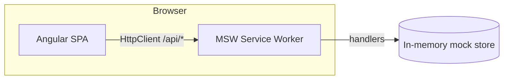
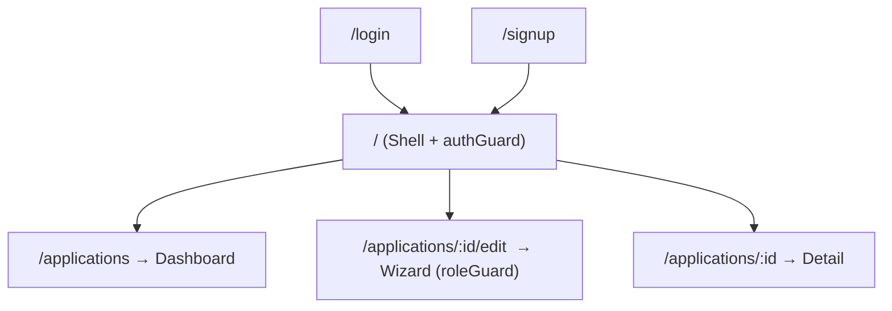
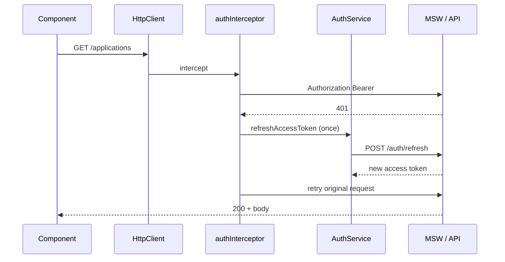
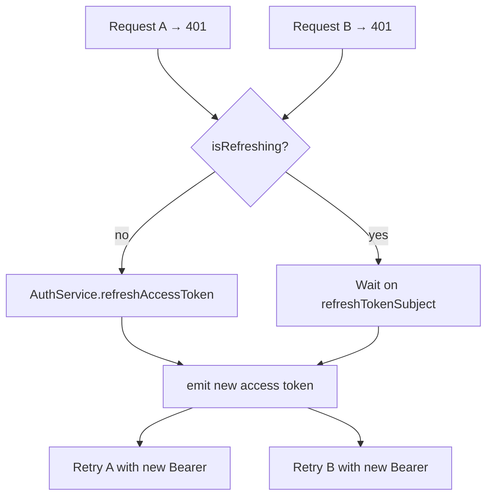
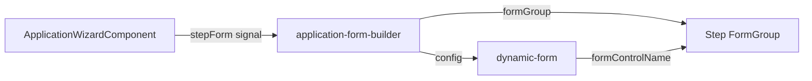
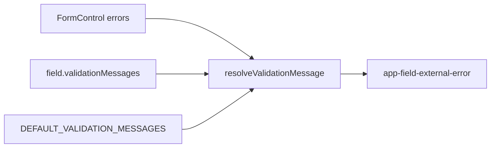
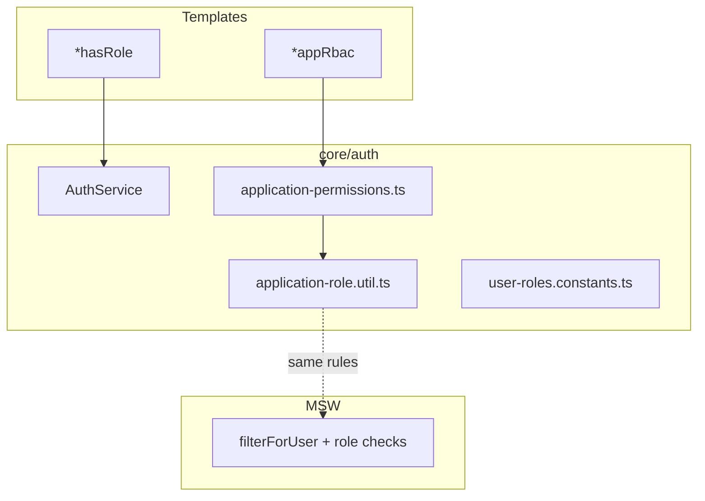

# Techkraft — Evaluator guide (complete documentation)

**One document for assignment review:** start with **[Must-needed implementations](#must-needed-implementations-checklist)** (codebase-verified checklist), then architecture, interceptors, guards, dynamic forms, validation, RxJS auto-save, masks, RBAC, tables, MSW, unit tests, and demo steps.

**UI:** Bootstrap 5 (layout); Angular Material (tables, stepper, outline fields, spinners). **Stack:** Angular 20 standalone, zoneless signals, reactive forms, MSW, Vitest.

---

## Table of contents

### Review path

1. [Executive summary](#executive-summary)
2. [Must-needed implementations (checklist)](#must-needed-implementations-checklist)
3. [Suggested demo walkthrough](#suggested-demo-walkthrough)
4. [Technology stack](#technology-stack)
5. [Senior competencies (at a glance)](#senior-competencies-at-a-glance)
6. [Quick start](#quick-start)

### System design

7. [Architecture](#architecture)
8. [Authentication](#authentication)
9. [HTTP auth interceptor](#http-auth-interceptor)
10. [Refresh token implementation & demonstration](#refresh-token-implementation--demonstration)
11. [Routing and guards](#routing-and-guards)
12. [MSW mock API](#msw-mock-api)

### Forms platform

13. [Dynamic forms and form fields](#dynamic-forms-and-form-fields)
14. [Validation and async validation](#validation-and-async-validation)
15. [Form state with RxJS (wizard auto-save)](#form-state-with-rxjs-wizard-auto-save)
16. [Input masking](#input-masking)

### Access control & data UI

17. [RBAC and structural directives](#rbac-and-structural-directives)
18. [Dashboard table and pagination](#dashboard-table-and-pagination)
19. [Feature screens](#feature-screens)
20. [Shared UI components](#shared-ui-components)

### Engineering practice

21. [Styling and SCSS](#styling-and-scss)
22. [Standalone component rules](#standalone-component-rules)
23. [Unit tests](#unit-tests)
24. [Assignment mapping](#assignment-mapping)
25. [Interview talking points](#interview-talking-points)
26. [Key source files](#key-source-files)
27. [CSP and security](#csp-and-security)

---

## Executive summary

**Techkraft** is a merchant payments application portal with **SALES / REVIEWER / ADMIN** roles, a **server-paginated dashboard**, a **four-step draft wizard** with **debounced auto-save**, **application detail and review**, and **masked sensitive fields**. The codebase uses **Angular 20 standalone components**, **zoneless change detection**, **signals-first UI state**, and a **config-driven Material dynamic form** layer.

Defense in depth: **route guards**, **structural RBAC directives**, and **MSW handlers** apply the same rules. **Functional HTTP interceptor** coalesces token refresh on concurrent 401s (with unit tests).

Use **[Must-needed implementations](#must-needed-implementations-checklist)** as the primary pass/fail checklist against the repo.

---

## Must-needed implementations (checklist)

This list was **verified by scanning** `src/app`, `src/mocks`, `src/main.ts`, `src/index.html`, and unit specs. Each row is something evaluators typically expect in this assignment; **Primary location** is where to open code first.

### Core assignment deliverables

| # | Must implement | What the app does | Primary location | How to verify quickly |
|---|----------------|-------------------|------------------|------------------------|
| A | **Application dashboard** | Server-driven list, filters, KPI stats, loading/error/retry, role-specific title/columns | `features/applications/dashboard/`, `application-list-table/`, `application-filters/`, `application-status-overview/` | Login → `/applications`; change search/status; sort columns; trigger retry on error |
| B | **Multi-step merchant form** | Linear Material stepper: Business → Owner → Banking → Review; nested reactive `FormGroup`s | `wizard/application-wizard.component.*`, `form/application-form.util.ts`, `application-form-builder/` | Create/edit draft; **Next** only validates current step (`validatedSteps` signal) |
| C | **Auto-save draft** | After **meaningful input**, `valueChanges` → `debounceTime(700)` → `PUT`; empty drafts hidden from list | `draft-input.util.ts`, `application-wizard.component.ts` | New app → type legal name → draft appears on dashboard after save |
| D | **Detail & review** | Accordion sections, risk history, review form (decision/risk/notes) gated by role + assignment | `detail/application-detail.component.*`, `canRecordReview()` in `application-role.util.ts` | REVIEWER on assigned app → **Record decision**; SALES → no review panel |
| E | **Role-based access (3 roles)** | SALES / REVIEWER / ADMIN with different list scope and actions | `core/auth/*`, `mocks/handlers.ts` (`filterForUser`), MSW 403 on illegal mutations | Same app id as SALES vs REVIEWER vs ADMIN |
| F | **Sensitive field display** | Mask tax ID, SSN, routing/account; reveal only REVIEWER/ADMIN | `shared/components/sensitive-field/` | Detail page; SALES sees mask only; REVIEWER can toggle reveal |
| G | **HTTP interceptor + refresh** | Bearer on API calls; single refresh on 401; retry; logout if refresh fails | `core/interceptors/auth.interceptor.ts`, `auth.service.ts` | Dashboard **Simulate token expiry** → Network: 401 → one `/auth/refresh` → 200 retries |
| H | **Mock refresh token API** | `POST /api/auth/refresh` with session store; dev simulate expiry | `mocks/handlers.ts`, `mocks/store.ts`, `mocks/auth.util.ts` | See [Refresh token demonstration](#refresh-token-implementation--demonstration) |
| I | **Unit tests (critical paths)** | Vitest: interceptor refresh, guards, RBAC, validators, major components | `src/app/**/*.spec.ts`, `testing/component-test-bed.ts` | `npm test` → 33 files / 59 tests |

### Forms, validation, and UX (required for B/C)

| Must implement | What the app does | Primary location |
|----------------|-------------------|------------------|
| **Config-driven dynamic form** | Material outline fields from `DynamicFormConfig`; masks on tax/phone/SSN | `shared/components/dynamic-form/`, `application-merchant-dynamic-form.config.ts` |
| **Sync validators** | EIN, phone, SSN, routing, required fields | `shared/validators/merchant.validators.ts`, `application-form.util.ts` |
| **Async duplicate checks** | Legal name & tax ID availability via HTTP | `application-field.validators.ts`, `GET /api/applications/field-availability` |
| **Validation messages** | Config overrides + `{Label} is required.` | `shared/constants/validation-messages.ts` → `resolveValidationMessage()` |
| **External field errors** | Errors below outline (not Material subscript) | `dynamic-form.component.*`, `styles.scss` |
| **Input masks** | Align display with validators | `*-mask.directive.ts`, `shared/formatters/*` |

Details: [Dynamic forms](#dynamic-forms-and-form-fields), [Validation](#validation-and-async-validation), [RxJS auto-save](#form-state-with-rxjs-wizard-auto-save).

### Security & routing (required for E/G)

| Must implement | What the app does | Primary location |
|----------------|-------------------|------------------|
| **Login + session** | Tokens in `sessionStorage`; restore on init | `auth.service.ts`, `token-storage.service.ts`, `app.config.ts` initializer |
| **Signup** | Register new user (MSW) | `features/auth/signup/` |
| **`authGuard`** | Shell routes require session | `core/guards/auth.guard.ts`, `app.routes.ts` |
| **`roleGuard`** | Wizard edit: SALES + ADMIN only | `role.guard.ts`, `applications.routes.ts` (`:id/edit` **before** `:id`) |
| **UI RBAC directives** | `*hasRole`, `*appRbac` with row `context:` | `has-role.directive.ts`, `app-rbac.directive.ts`, list table edit link |
| **Permission map** | Named permissions → same rules as MSW | `application-permissions.ts`, `application-role.util.ts` |
| **CSP (defense in depth)** | Sample meta policy in `index.html` | `src/index.html` |

Details: [RBAC](#rbac-and-structural-directives), [Routing and guards](#routing-and-guards), [CSP](#csp-and-security).

### Dashboard & table (required for A)

| Must implement | What the app does | Primary location |
|----------------|-------------------|------------------|
| **Server pagination** | Page/size from API `total`; not client-only slice | `table-pagination/`, `ApplicationApiService.list()` |
| **Server sort** | `sortBy` / `sortDirection` query params | `application-dashboard.component.ts`, `application-list-table` |
| **Debounced search** | `debounceTime(300)` on filter control | `application-dashboard.component.ts` |
| **Parallel load** | `forkJoin` list + stats | `application-dashboard.component.ts` → `load()` |
| **Create draft** | SALES + ADMIN only (`canCreateApplication`) | Dashboard `canCreate()`, `POST /api/applications` |
| **Edit / delete draft** | Row `*appRbac` for DRAFT; delete uses Material dialog | `application-list-table`, `applications.deleteDraft`, `draft-delete-dialog` |

Details: [Dashboard table and pagination](#dashboard-table-and-pagination).

### Admin & reviewer workflows (required for D/E)

| Must implement | What the app does | Primary location |
|----------------|-------------------|------------------|
| **Submit draft** | Wizard → `POST …/submit`; MSW may auto-assign reviewer | `application-wizard.component.ts`, `handlers.ts` |
| **Review decision** | `POST …/review`; updates status + risk history | `application-detail.component.ts`, `handlers.ts` |
| **Admin assign reviewer** | `PATCH …/assignment`; panel when SUBMITTED/IN_REVIEW | `showAssignmentPanel()`, `canManageAssignment()` |
| **Reviewer list API** | `GET /api/users/reviewers` | `application-api.service.ts`, `handlers.ts` |
| **Demo seed** | `app-1004` unassigned for admin assignment demo | `mocks/data/applications.seed.ts` |

Details: [Feature screens](#feature-screens), [MSW mock API](#msw-mock-api).

### Dev reliability (supports demo, not a separate grade item)

| Implementation | Purpose | Primary location |
|----------------|---------|------------------|
| **MSW bootstrap** | Real `HttpClient` in dev | `main.ts`, `mocks/browser.ts`, `environment.enableMsw` |
| **Draft survive reload** | `localStorage` cache + hydrate MSW memory | `mock-application-cache.service.ts`, `POST /api/dev/hydrate-applications` |
| **Zoneless CD** | Signals/effects without Zone.js | `app.config.ts` → `provideZonelessChangeDetection()` |
| **Async action UX** | Buttons with spinner while HTTP in flight | `action-button/` (login, wizard, detail, shell) |

### Explicitly out of scope (not in repo)

- Real backend / production JWT issuer  
- NgRx or global client store (local signals + `FormGroup` instead)  
- E2E Playwright/Cypress suite (unit tests only)  
- Public self-service role elevation (roles fixed in MSW seed / register defaults)

### Quick verification commands

```bash
npm run build    # production bundle; MSW off per environment
npm test         # must pass for checklist item I
npm start        # manual walkthrough in [Suggested demo walkthrough](#suggested-demo-walkthrough)
```

---

## Suggested demo walkthrough

| Step | Action | What to notice |
|------|--------|----------------|
| 1 | `npm install && npm start` → login as **SALES** | Quick-fill on login; dashboard title “My applications”; **New application** |
| 2 | Create draft → wizard | Empty draft is **not** listed until you enter a field; subtitle explains auto-save |
| 3 | Type e.g. legal name, pause ~1s | **Saving draft…** then saved time; row appears on dashboard (`hasMeaningfulDraftInput`) |
| 4 | **Back to applications** with unsaved edits | Material **Leave merchant application?** → Save draft & leave / Leave without saving / Stay |
| 5 | Reload browser on wizard (after save) | Draft still loads (MSW hydrate + `localStorage` cache in dev) |
| 6 | Dashboard → delete icon on DRAFT | **Delete draft?** Material dialog → `DELETE /api/applications/:id` |
| 7 | Dashboard → **Simulate token expiry** → change filter | See [Refresh token demonstration](#refresh-token-implementation--demonstration) |
| 8 | Logout → **REVIEWER** | Only assigned apps; review panel on detail |
| 9 | Logout → **ADMIN** | All apps; assign reviewer on **Northwind Pop-Up Retail** (`app-1004`) |

Run **`npm test`** to see **33 files / 59 tests** (interceptor, guards, RBAC, validators, components).

---

## Technology stack

| Layer | Choices | Why |
|--------|---------|-----|
| Framework | Angular 20, standalone | No NgModules; lazy `loadComponent` routes |
| Change detection | Zoneless + signals | Explicit updates; wizard `effect` + `untracked` load |
| Layout | Bootstrap 5 | Grid and utilities without custom layout CSS |
| Components | Angular Material 20 | Table, stepper, outline fields, paginator |
| Forms | Reactive + config UI | Sync validators + async duplicate checks on API |
| HTTP | `HttpClient` + `authInterceptor` | Bearer auth; refresh queue on 401 |
| Async | RxJS 7 + rxjs-interop | Auto-save pipeline; `toSignal` for route id |
| Dev API | MSW 2 | Realistic REST; role-scoped handlers |
| Tests | Vitest + TestBed | Interceptor, RBAC, forms, dashboard smoke |
| Styles | Sass `@use`, ITCSS-style layers | Tokens, mixins, feature partials |

---

## Senior competencies (at a glance)

| Area | Evidence in repo |
|------|------------------|
| Architecture | `core` / `features` / `shared` / lazy routes; `:id/edit` before `:id` |
| Modern Angular | `inject()`, signals, `effect()`, functional guards & interceptor |
| Security-minded UI | Guards + MSW + `*hasRole` / `*appRbac`; `SensitiveFieldComponent`; CSP meta |
| Forms at scale | `DynamicFormConfig` + `buildApplicationForm()` + `resolveValidationMessage()` |
| Resilience | Loading/error/retry; auto-save errors do not wipe form |
| Testability | Pure validator/formatter specs; interceptor concurrent 401 test |

---

## Quick start

```bash
npm install
npm start          # http://localhost:4200 — MSW enabled in dev
npm test           # Vitest + TestBed (33 files, 59 tests)
npm run build      # production build (MSW disabled)
```

Demo users (password for all: `password`):

| Role     | Email                    |
|----------|--------------------------|
| SALES    | `sales@merchant.test`    |
| REVIEWER | `reviewer@merchant.test` |
| ADMIN    | `admin@merchant.test`    |

**Token refresh demo:** Full steps in [Refresh token implementation & demonstration](#refresh-token-implementation--demonstration).

---

## Authentication

**Files:** `src/app/core/auth/auth.service.ts`, `token-storage.service.ts`, `core/models/user.model.ts`

| Behavior | Detail |
|----------|--------|
| Login | `POST /api/auth/login` → access + refresh tokens in **sessionStorage** |
| Session | `user` signal (id, email, displayName, role); `APP_INITIALIZER` restores from non-expired access token |
| Authorization helpers | `hasRole(...roles)`, `role()` for guards and directives |
| Logout | Clears storage → `/login` |

**Login UI** (`LoginComponent`, `/login`): reactive email/password, demo quick-fill buttons, `action-button` loading state. **Signup** (`SignupComponent`, `/signup`): registration flow outside the shell.

---

## Architecture

### System context



In development, MSW starts before `bootstrapApplication`. Production uses the same `ApplicationApiService` URLs without MSW (see environment flags).

### Layered structure

```
src/
  app/
    core/           Auth, guards, interceptors, API services, models
    features/       Lazy screens (auth, applications: dashboard, wizard, detail)
    layout/         Authenticated shell (toolbar + router-outlet)
    shared/         Dynamic form, validators, formatters, masks, RBAC directives
  mocks/            MSW handlers, seed data, session store, dev hydrate endpoint
  styles/           Sass layers
```

| Layer        | May import                         | Must not              |
|--------------|------------------------------------|-----------------------|
| `features/*` | `core`, `shared`, `@angular/*`     | Other features directly |
| `shared/*`   | `core` models sparingly            | `features/*`          |
| `core/*`     | Angular, RxJS, models              | Feature components    |

### Bootstrap (`app.config.ts`)

- `provideZonelessChangeDetection()` — signal-driven UI.
- `provideRouter(routes, withComponentInputBinding())`.
- `provideHttpClient(withInterceptors([authInterceptor]))`.
- `provideAppInitializer` — `AuthService.restoreSessionFromStorage()`; optional MSW draft **hydrate** from `localStorage` via `POST /api/dev/hydrate-applications`.

**State philosophy:** No NgRx. Session in `AuthService` signals; screen state in component `signal()` / `computed()`; **draft payload source of truth** is the reactive `FormGroup` on the wizard.

### Routing topology



All route components are **standalone** and lazy-loaded via `loadComponent` / `loadChildren`.

---

## HTTP auth interceptor

**File:** `src/app/core/interceptors/auth.interceptor.ts`  
**Test:** `src/app/core/interceptors/auth.interceptor.spec.ts`



### Behavior

1. Attach `Authorization: Bearer <accessToken>` to all requests except `/auth/login`, `/auth/register`, and `/auth/refresh`.
2. On **401**, start a single `refreshAccessToken()` call (`isRefreshing` flag).
3. **Concurrent 401s** wait on a shared `BehaviorSubject<string | null>` (`refreshTokenSubject`); when refresh completes, each waiter retries once with the new token.
4. If refresh fails → `logout()`.

Module-level coalescing keeps one refresh for many parallel failing requests (typical after token expiry or tab wake).

---

## Refresh token implementation & demonstration

This assignment requires a **mock refresh-token flow** wired through real `HttpClient` calls and a **functional interceptor** — not a fake “always succeed” service. The dashboard includes a **Simulate token expiry** control so evaluators can trigger the path without waiting five minutes.

### Token model (client)

| Token | Storage | Key / format | Used for |
|-------|---------|--------------|----------|
| **Access** | `sessionStorage` | `mp_access_token` — `mock-access.<base64 JSON claims>` | `Authorization: Bearer` on API calls |
| **Refresh** | `sessionStorage` | `mp_refresh_token` — opaque id (e.g. `refresh-…`) | Body of `POST /api/auth/refresh` only |

**Files:** `src/app/core/auth/token-storage.service.ts`, `src/app/core/auth/auth.service.ts`

- **Login / register:** `AuthService` stores both tokens and sets the `user` signal from the response.
- **Refresh:** `refreshAccessToken()` posts `{ refreshToken }`, replaces **both** tokens in storage (MSW may rotate access; refresh id stays the same in this mock), returns the new access token string for the interceptor.
- **Session restore:** `restoreSessionFromStorage()` decodes the access JWT payload client-side; if `exp` is in the past, storage is cleared (no silent refresh on cold start in this demo).
- **Logout:** Clears storage and navigates to `/login`.

Access tokens are issued with a **5-minute TTL** in MSW (`ACCESS_TTL_MS` in `src/mocks/auth.util.ts`). The simulate button forces expiry **immediately** for demo purposes.

### Refresh API (MSW)

**Handler:** `POST /api/auth/refresh` in `src/mocks/handlers.ts`

1. Look up `refreshToken` in the in-memory **session map** (`store.ts` → `getSession`).
2. If missing → **401** `Invalid refresh token`.
3. Issue a **new access token** for the session’s user, update session record, call `setForceAccessExpired(false)`.
4. Respond with `{ accessToken, refreshToken, expiresIn: 300 }` (same refresh id as request).

Login and successful refresh both clear the “force expired” flag so API calls work again.

### Why protected APIs return 401 after “Simulate token expiry”

MSW validates every protected request via `isAccessTokenValid()` in `auth.util.ts`:

```text
valid = parseable mock-access token
        AND claims.exp > Date.now()
        AND NOT getForceAccessExpired()
```

**Simulate** calls `POST /api/dev/simulate-token-expiry` → `setForceAccessExpired(true)`. The client still sends the **same** Bearer string, but MSW treats it as invalid → **401 Unauthorized** on `/api/applications`, stats, etc.

That 401 is what drives the **interceptor refresh path** (not a special client-side flag).

### End-to-end flow (interceptor + auth service)

```mermaid
sequenceDiagram
  participant UI as Dashboard
  participant API as ApplicationApiService
  participant H as HttpClient + interceptor
  participant MSW as MSW handlers
  participant Auth as AuthService

  UI->>API: simulateTokenExpiry()
  API->>MSW: POST /dev/simulate-token-expiry
  MSW-->>API: ok (forceAccessExpired = true)

  UI->>API: load() → GET /applications (+ stats)
  H->>MSW: Bearer old access
  MSW-->>H: 401

  Note over H: isRefreshing = true (first 401)
  H->>Auth: refreshAccessToken()
  Auth->>MSW: POST /auth/refresh { refreshToken }
  MSW-->>Auth: new accessToken
  Auth-->>H: new-access-token

  Note over H: refreshTokenSubject emits; retry originals
  H->>MSW: GET /applications (new Bearer)
  MSW-->>UI: 200 + paged data
```

**Concurrent 401s:** If `load()` fires multiple requests (list + stats), the first 401 starts refresh; others wait on `refreshTokenSubject` and retry once — see `auth.interceptor.ts` (`isRefreshing`, `BehaviorSubject`).

**Refresh failure:** If refresh returns 401 or errors, interceptor calls `AuthService.logout()` (covered in unit test).

### Live demonstration (evaluator checklist)

1. Run `npm start`, sign in as any demo user, open **Applications** dashboard.
2. Open browser **DevTools → Network**; filter by `Fetch/XHR`.
3. Click **Simulate token expiry** (filter toolbar).  
   - Expect: `POST /api/dev/simulate-token-expiry` → **200**.  
   - Dashboard calls `load()` immediately after (button shows loading via `simulatingExpiry` signal).
4. On the next protected calls you should see:
   - One or more **401** responses on `GET /api/applications` and/or `GET /api/applications/stats`.
   - Exactly **one** `POST /api/auth/refresh` with JSON body `{ "refreshToken": "…" }`.
   - **Retried** GETs with **200** and the table/stats populate (user stays logged in).
5. Optional: click **Simulate token expiry** again, then change **status filter** or **search** to trigger another wave — same pattern (401 → refresh → retry).
6. To observe **logout on failed refresh**: invalid refresh token in storage (manual DevTools edit) → simulate expiry → API call → refresh 401 → redirect to login.

**UI wiring:**

| Piece | Location |
|-------|----------|
| Button | `application-filters` → `(simulateExpiry)` |
| Handler | `ApplicationDashboardComponent.simulateExpiry()` → `ApplicationApiService.simulateTokenExpiry()` |
| MSW | `handlers.ts` → `setForceAccessExpired(true)` |

After simulate, `simulateExpiry()` also calls `load()`, so evaluators often see list + stats refresh in one action without an extra click.

### Concurrent refresh (single flight)



### Verified by unit tests

**File:** `src/app/core/interceptors/auth.interceptor.spec.ts`

| Test | Proves |
|------|--------|
| `refreshes once and retries concurrent 401 responses` | Two parallel `GET /api/applications` → one `refreshAccessToken()` → two successful retries |
| `logs out when refresh fails` | 401 + failed refresh → `logout()`; no silent retry loop |

Run: `npm test` (included in the full suite).

### Production notes (talking point)

Real APIs often use **httpOnly cookies** for refresh tokens and **rotating refresh** ids; this demo uses **sessionStorage** and a visible Bearer access token so Network tab review is easy. The **interceptor pattern** (single in-flight refresh + retry queue) is the same shape production SPAs use.

---

## Routing and guards

**Files:** `src/app/app.routes.ts`, `src/app/features/applications/applications.routes.ts`, `src/app/core/guards/auth.guard.ts`, `src/app/core/guards/role.guard.ts`

| Guard | Purpose |
|-------|---------|
| **`authGuard`** | Shell and children require `AuthService.isAuthenticated()`. Unauthenticated users redirect to `/login`. |
| **`roleGuard(['SALES', 'ADMIN'])`** | Wizard edit route `/applications/:id/edit` — **REVIEWER** cannot open the draft editor. |

Public routes: `/login`, `/signup` (no shell). Authenticated app lives under `/` → `ShellComponent` → lazy `applications` children.

Guards enforce **navigation**; they do not replace API authorization (MSW still returns 403 for forbidden mutations).

**Route order:** Register `/applications/:id/edit` **before** `/applications/:id` so edit URLs are not captured by the detail route.

---

## MSW mock API

**Files:** `src/mocks/browser.ts`, `handlers.ts`, `store.ts`, `data/*` — enabled when `environment.enableMsw` (`main.ts`).

| Method | Path | Notes |
|--------|------|--------|
| POST | `/api/auth/login`, `/api/auth/register` | Tokens + user |
| POST | `/api/auth/refresh` | New access token |
| GET | `/api/applications` | Paginated, filtered, **role-scoped** |
| GET | `/api/applications/stats` | KPIs scoped like list |
| GET | `/api/applications/:id` | Detail with same visibility rules |
| POST | `/api/applications` | Create draft (SALES / ADMIN) |
| PUT | `/api/applications/:id` | Update draft |
| POST | `/api/applications/:id/submit` | Submit; auto-assign reviewer (demo) |
| POST | `/api/applications/:id/review` | Reviewer / admin decision |
| PATCH | `/api/applications/:id/assignment` | Admin reviewer assignment |
| GET | `/api/applications/field-availability` | Async duplicate legal name / tax ID (`excludeId`) |
| POST | `/api/dev/simulate-token-expiry` | Force 401 until refresh |
| POST | `/api/dev/hydrate-applications` | Restore in-memory store from client cache on reload |

**Row-level security:** `filterForUser()` — SALES own rows, REVIEWER assigned rows, ADMIN all. Mutating handlers re-check role + ownership.

---

## Dynamic forms and form fields

Merchant data entry combines **reactive `FormGroup`**, **JSON-like field config**, and a **Material renderer**.

### Goals

1. Single source for labels, layout, masks, and user-facing error copy (no per-field HTML duplication).
2. Business validators stay on the `FormGroup` (including async server checks).
3. Material outline fields; wizard uses a fixed subscript strategy (external errors — see Validation).
4. Step-scoped validation: only steps the user attempted show errors.

### File map

| Path | Role |
|------|------|
| `shared/models/dynamic-form.model.ts` | `DynamicFormConfig`, `FormField`, conditions |
| `shared/services/dynamic-form.service.ts` | Config validation, conditions, optional `createForm` |
| `shared/components/dynamic-form/*` | Renderer, `@switch` on `field.type`, select options |
| `shared/components/form-fields/form-text-field.component.ts` | Reusable text field with masks + `ControlContainer` |
| `features/applications/form/application-merchant-dynamic-form.config.ts` | Business / owner / banking configs |
| `features/applications/form/application-form.util.ts` | `buildApplicationForm()`, payload mapping |
| `features/applications/form/application-form-builder.component.ts` | Section config + step `FormGroup` binding |
| `shared/constants/validation-messages.ts` | Defaults + `resolveValidationMessage()` |

### Rendering pipeline



**Child component pattern:** `formGroupName` on a parent does not propagate into a child template. The builder binds `[formGroup]="stepForm()"` locally; `dynamic-form` and `form-text-field` use `ControlContainer` with `skipSelf: true` so `formControlName` resolves against the step group.

### Config shape (excerpt)

```typescript
{
  formId: 'merchant-business',
  layout: 'grid',
  sections: [{
    id: 'business',
    fields: [
      { id: 'legalName', name: 'legalName', type: 'text', label: 'Legal name', halfWidth: true, isRequired: true },
      { id: 'taxId', name: 'taxId', type: 'text', mask: 'taxId', label: 'Tax ID (EIN)' },
    ],
  }],
}
```

`halfWidth` / `fullWidth` map to Bootstrap `col-12 col-md-6` vs `col-12` inside `row g-3`.

### `form-text-field`

Standalone control used where a single Material outline input is enough (same mask directives as `dynamic-form`). Inputs: `label`, `controlName`, optional `colClass`, optional `FormFieldErrorConfig` for external errors.

### `DynamicFormService`

- `validateFormConfig()` — structural checks.
- `getFields()` / `findField()` — flatten sections.
- `evaluateConditions()` — show/hide fields when conditions are configured.
- Wizard uses `buildApplicationForm()` instead of generic `createForm()` so merchant async validators stay centralized.

Select fields: `FormField.options` may be a static array or `Observable<unknown[]>`; `dynamic-form` resolves observables into a signal for `@for` in the template.

---

## Validation and async validation

### Layers

| Layer | When | What |
|-------|------|------|
| Sync | Control create | `Validators.required`, `taxIdValidator`, `phoneValidator`, `ssnValidator`, routing rules — `merchant.validators.ts` |
| Async | Value change (Angular async validator pipeline) | Duplicate **legal name** / **tax ID** via `ApplicationApiService.checkFieldAvailability` — `application-field.validators.ts` |
| UI display | Touch, step **Next**, or **Submit** | External `.app-field-external-error`; invalid outline class when step is in `validatedSteps` |
| Stepper header | Step marked validated | “Incomplete Details” when that step’s group is invalid |

### Message resolution

**File:** `src/app/shared/constants/validation-messages.ts` — `resolveValidationMessage(control, field)`



**Required message order:**

1. Custom `validationMessages.required` if not the generic “This field is required.”
2. Else `{field.label} is required.`
3. Other keys: config → defaults; `{label}` / `{0}` tokens from validator payload.

`<dynamic-form>` hides Material’s default subscript for these fields so errors sit in one predictable place below the control.

### Async validators (concept)

Async validators return `Observable<ValidationErrors | null>`. Here they call `GET`-style availability checks (MSW) with the current application id so edits of the same draft do not false-positive. Controls show `PENDING` while async validation runs; the wizard’s **Next** / **Submit** logic respects `status === 'PENDING'` on step groups.

**Files:** `application-form.util.ts` (wires async validators on `legalName`, `taxId`), `application-field.validators.ts`, `application-api.service.ts`, MSW handlers for field check.

### Per-step validation (wizard)

- `validatedSteps: signal<Set<WizardFormStep>>` — current step added on **Next** only.
- `[showValidation]="stepShowValidation('business')"` — not a global “show all errors” flag.
- **Submit** → `markAllStepsValidated()` and navigate to the first invalid step.
- `valueChanges` / `statusChanges` on the root form call `syncValidatedSteps()` so fixing fields can clear step header errors.

**Test:** `wizard-step-errors.util.spec.ts`, `validation-messages.spec.ts`, `merchant.validators.spec.ts`.

---

## Form state with RxJS (wizard auto-save)

**Component:** `ApplicationWizardComponent`  
**Route:** `/applications/:id/edit`

The reactive `FormGroup` is the **source of truth** for draft content. Server state is synchronized with RxJS streams inside Angular `effect()` blocks:

| Stream | Purpose |
|--------|---------|
| `paramMap` → `applicationId` | `effect` + `untracked(loadDraft)` loads draft when route id changes without reload loops when `form` updates |
| `form.statusChanges` / `form.valueChanges` | Recompute which validated steps are still invalid |
| `form.valueChanges` → pipeline below | Auto-save |

### Auto-save pipeline

Auto-save runs **only when** `hasMeaningfulDraftInput()` is true (at least one business, owner, or banking field filled). Empty drafts created via **New application** stay in MSW until first save but are **excluded** from dashboard list/stats via `isListableDraftApplication()` in `draft-input.util.ts` and `visibleApplicationsForUser()` in MSW.

```typescript
fg.valueChanges.pipe(
  debounceTime(700),
  distinctUntilChanged(/* … */),
  filter(() => hasMeaningfulDraftInput(formValueToPayload(fg))),
  tap(() => this.saveState.set('saving')),
  switchMap(() => this.api.save(id, formValueToPayload(fg)) /* … */),
)
```

### Leave wizard: save draft dialog

When navigating away from `/applications/:id/edit` with **unsaved meaningful changes**, `draftWizardCanDeactivate` calls `ApplicationWizardComponent.confirmLeave()`:

| User choice | Behavior |
|-------------|----------|
| **Stay on page** | Cancel navigation |
| **Leave without saving** | Navigate away; server keeps last successful auto-save |
| **Save draft & leave** | `PUT` current form, then navigate |

If the user leaves with **no meaningful input**, the empty server draft is **deleted** (`DELETE`) so `(Untitled draft)` rows do not accumulate.

**UI:** `shared/components/draft-leave-dialog/` (Material dialog). **Guard:** `core/guards/draft-wizard.guard.ts` + `canDeactivate` on wizard route.

**Delete from dashboard:** red delete icon on DRAFT rows (RBAC) → `draft-delete-dialog/` confirmation → `ApplicationApiService.deleteDraft()`.

```typescript
fg.valueChanges.pipe(
  debounceTime(700),
  distinctUntilChanged((a, b) => JSON.stringify(a) === JSON.stringify(b)),
  filter(() => hasMeaningfulDraftInput(formValueToPayload(fg))),
  tap(() => this.saveState.set('saving')),
  switchMap(() =>
    this.api.save(id, formValueToPayload(fg)).pipe(
      catchError(() => { this.saveState.set('error'); return of(null); }),
    ),
  ),
  filter((res): res is MerchantApplication => res !== null),
).subscribe((saved) => {
  this.saveState.set('saved');
  this.lastSavedAt.set(new Date(saved.updatedAt));
  this.captureSavedSnapshot(fg);
});
```

- **Debounced** saves reduce API noise while typing.
- **`switchMap`** cancels an in-flight save if the user changes the form again.
- **Failure** sets error state; the form is **not** cleared.
- **Submit** saves then `POST /applications/:id/submit`.

**Dev reload:** MSW memory resets on refresh; `MockApplicationCacheService` + hydrate endpoint repopulates drafts from `localStorage`.

---

## Input masking

Mask directives format display input and align with sync validators and formatters.

| Mask | Display | Files |
|------|---------|--------|
| Tax ID (EIN) | `XX-XXXXXXX` | `tax-id-mask.directive.ts`, `tax-id.format.ts` |
| Phone | `(XXX) XXX-XXXX` | `phone-mask.directive.ts`, `phone.format.ts` |
| SSN | `XXX-XX-XXXX` | `ssn-mask.directive.ts`, `ssn.format.ts` |

Used on `dynamic-form` and `form-text-field`. Payload builders read control values; load from API uses formatters to normalize seed data.

---

## RBAC and structural directives

Authorization is enforced in **MSW handlers** and mirrored in the **UI** so users do not see actions the API would reject.



### Role matrix (applications)

| Capability | SALES | REVIEWER | ADMIN |
|------------|:-----:|:--------:|:-----:|
| See applications | Own | Assigned | All |
| Create / edit / submit draft | Own drafts | No | Yes (support / demo) |
| Review decision | No | Assigned queue | Yes |
| Assign reviewer | No | No | Yes |

**Data scoping:** SALES → `createdByUserId`; REVIEWER → `assignedReviewerId`; ADMIN → all.

### Directives

| Directive | Use |
|-----------|-----|
| `*hasRole` | Show when signed-in user has role(s). Optional `hasRoleMatch`. |
| `*appRbac` | Show when named permission passes; optional row **`context`** for list actions. |

```html
<button *hasRole="['SALES', 'ADMIN']">New application</button>

<ng-container
  *appRbac="'applications.editDraft'; context: { status: row.status, createdByUserId: row.createdByUserId }"
>
  <a [routerLink]="['/applications', row.id, 'edit']">Edit</a>
</ng-container>
```

**Permissions:** `applications.create`, `applications.editDraft`, `applications.submitDraft`, `applications.assignReviewer`, `applications.review` — `hasApplicationPermission()` in `application-permissions.ts`.

**Code:** `has-role.directive.ts`, `app-rbac.directive.ts`, `application-role.util.ts`, `handlers.ts`.

**Tests:** `has-role.directive.spec.ts`, `app-rbac.directive.spec.ts`, `application-role.util.spec.ts`, `application-permissions.spec.ts`, `role.guard.spec.ts`.

---

## Dashboard table and pagination

**Component:** `ApplicationDashboardComponent` — route `/applications`

### Responsibilities

- Material **`mat-table`** with role-aware columns (`ApplicationListTableComponent`).
- **Server-side** pagination and filtering (not client-only slicing).
- Status overview KPIs, loading / error / retry, empty state.
- **New application** when `canCreate()` (SALES, ADMIN).
- Filter toolbar: debounced search + status; compact Material fields with placeholders.

### Data flow

1. Signals hold `page`, `pageSize`, `status`, `search`, `total`, loading, error.
2. `ApplicationApiService.list()` sends query params; MSW returns `PagedResult<ApplicationListItem>` after `filterForUser`.
3. `onPage($event)` updates signals and calls `load()` again.

### `table-pagination`

**Path:** `src/app/shared/components/table-pagination/`

Wrapper around Material paginator for **server-driven** tables. Parent owns page state and reloads on `pageChange`.

| Input | Meaning |
|-------|---------|
| `length` | Total count from API |
| `pageIndex` | Zero-based page |
| `pageSize` | Rows per page |
| `pageSizeOptions` | e.g. `[5, 10, 25]` |

| Output | Meaning |
|--------|---------|
| `pageChange` | Material `PageEvent` |

```html
<table-pagination
  [length]="total()"
  [pageIndex]="page()"
  [pageSize]="pageSize()"
  (pageChange)="onPage($event)"
/>
```

**Tests:** `application-dashboard.component.spec.ts`, `application-list-table.component.spec.ts`, `application-filters.component.spec.ts`, `table-pagination.component.spec.ts`.

**UI by role:** SALES sees own list + edit own drafts; REVIEWER sees assigned queue; ADMIN sees all columns, unassigned badge, assignment on detail.

---

## Feature screens

| Screen | Route | Component | Highlights |
|--------|-------|-----------|------------|
| Login | `/login` | `LoginComponent` | Validation, demo users, no shell |
| Signup | `/signup` | `SignupComponent` | Register outside shell |
| Shell | `/` | `ShellComponent` | Material toolbar, user info, sign-out `action-button` |
| Dashboard | `/applications` | `ApplicationDashboardComponent` | Filters, stats, table, pagination, token expiry demo |
| Wizard | `/applications/:id/edit` | `ApplicationWizardComponent` | Stepper, auto-save, submit (`roleGuard`) |
| Detail | `/applications/:id` | `ApplicationDetailComponent` | Accordion sections, risk history, review + assignment panels |

**Detail & review:** Sensitive values via `sensitive-field`. Review panel for REVIEWER (assigned) or ADMIN when status is `SUBMITTED` / `IN_REVIEW`; hidden for SALES. `POST /applications/:id/review` sets decision, risk level, notes, appends history.

**Wizard steps:** Business → Owner → Banking → Review. Submit runs save then `POST …/submit`.

---

## Shared UI components

| Component | Path | Purpose |
|-----------|------|---------|
| `action-button` | `shared/components/action-button/` | Material button + inline spinner when `[loading]` |
| `table-pagination` | `shared/components/table-pagination/` | Server-side paginator wrapper (see Dashboard) |
| `sensitive-field` | `shared/components/sensitive-field/` | Mask by default; REVIEWER/ADMIN reveal toggle |
| `page-back-nav` | `shared/components/page-back-nav/` | Consistent back link |
| `dynamic-form` | `shared/components/dynamic-form/` | Config-driven Material fields |
| `form-text-field` | `shared/components/form-fields/` | Single outline field + masks |

Example:

```html
<action-button variant="flat" color="primary" [loading]="saving()" (pressed)="save()">
  Save
</action-button>
```

---

## Styling and SCSS

**Global:** `src/styles.scss` — Bootstrap 5 + Angular Material theme.

**Layered Sass** (`src/styles/`):

```
abstracts/   variables, functions, mixins (breakpoints, status colors, outline field mixins)
themes/      CSS custom properties for applications feature
features/    dashboard, wizard, detail partials
```

Components `@use` only needed partials; `angular.json` sets `stylePreprocessorOptions.includePaths: ["src"]`.

**Form UX:** Token-based Material outline focus/error; dynamic form errors in `.app-field-external-error` below the field (subscript hidden on `<dynamic-form>`). Status chips use Sass maps → CSS variables.

---

## Standalone component rules

This app is **100% NgModule-free**.

- Every component: `standalone: true`, explicit `imports`, `templateUrl` + `styleUrl`.
- Bootstrap: `bootstrapApplication(App, appConfig)` — providers in `app.config.ts`.
- Lazy routes: `loadComponent` / `loadChildren` with functional `authGuard`, `roleGuard`, `authInterceptor`.
- Services: `providedIn: 'root'` unless route-scoped.

```
app/
  app.ts, app.config.ts, app.routes.ts
  core/          guards, interceptors, services (no feature components)
  features/      route-owned screens
  layout/        ShellComponent
  shared/        reusable widgets, directives, validators
```

CLI `angular.json` defaults `standalone: true` for new components.

---

## Unit tests

```bash
npm test    # Vitest via Angular experimental unit-test builder
```

| Area | Spec files (examples) |
|------|------------------------|
| Interceptor | `auth.interceptor.spec.ts` — 401 refresh + retry |
| Guards | `auth.guard.spec.ts`, `role.guard.spec.ts` |
| RBAC | `has-role.directive.spec.ts`, `app-rbac.directive.spec.ts`, `application-permissions.spec.ts`, `application-role.util.spec.ts` |
| Validation | `validation-messages.spec.ts`, `merchant.validators.spec.ts`, `wizard-step-errors.util.spec.ts`, formatters |
| Forms / wizard | `dynamic-form.component.spec.ts`, `application-form-builder.component.spec.ts`, `application-wizard.component.spec.ts`, `form-text-field.component.spec.ts` |
| Dashboard / table | `application-dashboard.component.spec.ts`, `application-list-table.component.spec.ts`, `application-filters.component.spec.ts`, `table-pagination.component.spec.ts` |
| Auth UI / shell | `login.component.spec.ts`, `signup.component.spec.ts`, `shell.component.spec.ts`, `app.spec.ts` |

**Helpers:** `src/app/testing/component-test-bed.ts` (`provideComponentTesting()`), `mock-application-api.ts`.

**Coverage:** 33 spec files, **59 tests** — all major standalone components plus core utilities listed above.

---

## Assignment mapping

This table maps **assignment letters** to the repo. The authoritative checklist (with file paths and verify steps) is **[Must-needed implementations](#must-needed-implementations-checklist)**.

| Letter | Requirement | Implementation summary | Deep dive |
|--------|-------------|------------------------|-----------|
| A | Dashboard | Server pagination, sort, debounced filters, stats, error/retry, role-aware table | [Dashboard](#dashboard-table-and-pagination) |
| B | Multi-step form | Material linear stepper + `buildApplicationForm()` + dynamic form builder | [Dynamic forms](#dynamic-forms-and-form-fields) |
| C | Auto-save | RxJS `debounceTime(700)` + `PUT` draft | [Form state with RxJS](#form-state-with-rxjs-wizard-auto-save) |
| D | Detail & review | Accordion detail, review panel, admin assignment | [Feature screens](#feature-screens) |
| E | Roles | Guards + directives + MSW `filterForUser` | [RBAC](#rbac-and-structural-directives) |
| F | Sensitive data | `sensitive-field` mask/reveal by role | [Shared UI](#shared-ui-components) |
| — | HTTP interceptor | Functional interceptor, refresh coalescing | [Interceptor](#http-auth-interceptor), [Refresh demo](#refresh-token-implementation--demonstration) |
| — | Mock refresh | MSW `/auth/refresh` + simulate expiry | [Refresh demo](#refresh-token-implementation--demonstration) |
| — | Tests | Vitest 33 / 59 | [Unit tests](#unit-tests) |

---

## Interview talking points

1. **Zoneless + signals:** Wizard load keyed on route id uses `effect` + `untracked(loadDraft)` so updating `form()` does not re-fetch in a loop.
2. **Nested FormGroup in children:** `formGroupName` does not cross standalone boundaries — pass step group via signal input and `[formGroup]` on the builder.
3. **MSW vs fake services:** Exercises real `HttpClient`, interceptors, and HTTP errors; handlers enforce the same RBAC as production would.
4. **Production path:** Swap `apiBaseUrl`; CSP on response headers; optional Playwright on wizard + refresh.
5. **Structural RBAC:** One permission map (`application-permissions.ts`) shared with MSW; `*appRbac` + `context:` for row actions without `canEdit(row)` methods everywhere.
6. **`resolveValidationMessage`:** Compliance-friendly copy in config; consistent `{Label} is required.` when config uses generic required text.
7. **Interceptor refresh:** `isRefreshing` + `BehaviorSubject` — classic “single flight” pattern for parallel 401s.

---

## Key source files

| Topic | Primary files |
|-------|----------------|
| Interceptor | `core/interceptors/auth.interceptor.ts`, `auth.interceptor.spec.ts` |
| Refresh / tokens | `core/auth/auth.service.ts`, `token-storage.service.ts`, `mocks/handlers.ts` (`/auth/refresh`, `/dev/simulate-token-expiry`), `mocks/auth.util.ts`, `mocks/store.ts` (`forceAccessExpired`) |
| Refresh demo UI | `application-dashboard.component.ts`, `application-filters`, `application-api.service.ts` → `simulateTokenExpiry()` |
| Guards | `core/guards/auth.guard.ts`, `role.guard.ts`, `app.routes.ts`, `applications.routes.ts` |
| RBAC | `core/auth/application-role.util.ts`, `application-permissions.ts`, `user-roles.constants.ts`, `shared/directives/has-role.directive.ts`, `app-rbac.directive.ts` |
| Dynamic form | `shared/components/dynamic-form/*`, `application-merchant-dynamic-form.config.ts`, `application-form-builder.component.ts` |
| Validators | `shared/validators/merchant.validators.ts`, `application-field.validators.ts`, `validation-messages.ts` |
| Wizard / RxJS | `features/applications/wizard/application-wizard.component.ts`, `application-form.util.ts` |
| Dashboard | `features/applications/dashboard/*`, `application-list-table/*`, `application-filters/*` |
| MSW | `src/mocks/handlers.ts`, `store.ts` |
| Tests | `src/app/**/*.spec.ts`, `src/app/testing/component-test-bed.ts` |

Merchant dynamic-form wiring is covered in [Dynamic forms and form fields](#dynamic-forms-and-form-fields) and [Validation and async validation](#validation-and-async-validation) above.

---

## CSP and security

`src/index.html` includes a sample CSP meta tag (`default-src 'self'`, restricted `script-src` / `connect-src`, `frame-ancestors 'none'`). Prefer CSP **response headers** in production and tune `connect-src` for your API host.

- Fictional seed data only; no real PII or card numbers.
- Tokens in `sessionStorage` for the demo only.
- Do not commit `.env` or real credentials.

**AI assistance disclosure:** Built with AI coding assistance (Cursor). Behavior verified with `npm run build` and `npm test`. Be ready to explain interceptor refresh coalescing, RBAC alignment with MSW, debounced auto-save, and async duplicate-field validation in review.
